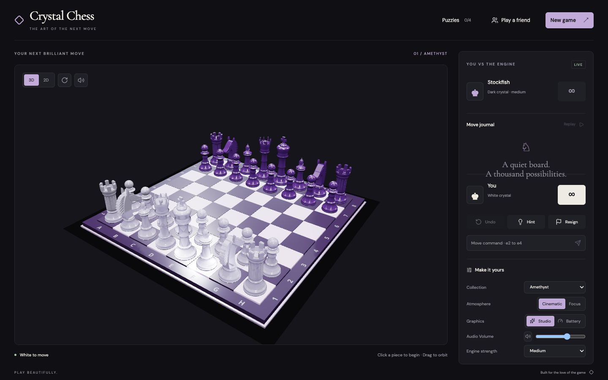

# Crystal Chess

An atmospheric 3D chess experience built around hand-cut crystal pieces, cinematic replay, Stockfish, tactical puzzles, and private friend matches.



## Highlights

- Play Stockfish at five strengths, share a local board, or invite a friend with a private link.
- Switch between a cinematic WebGL board and a lightweight, keyboard-accessible 2D board.
- Review every move, orbit the replay camera, and export the final sequence as video.
- Solve curated tactics with progressive hints.
- Choose Amethyst, Obsidian Gold, or Frost materials and tune sound, motion, and rendering quality.
- Resume local games automatically after refreshing the page.
- Enable continuous voice mode and play hands-free with commands such as “pawn to e four,” “e two to e four,” and “castle kingside.”

## Run locally

Requires Node.js 22 or newer.

```bash
npm install
npm run dev
```

Open `http://localhost:3000`. The development command starts Vite and the multiplayer room server.

## Commands

```bash
npm run dev        # frontend and room server
npm run build      # production client bundle
npm start          # serve dist and WebSocket rooms
npm test           # unit and integration tests
npm run test:e2e   # critical browser journeys
npm run check      # full local verification
```

## Architecture

- `ChessController` owns rules, clocks, history, results, and saved games.
- `chess.js` validates every move; Stockfish runs in a Web Worker.
- React Three Fiber renders crystal pieces. The 2D board uses semantic DOM controls.
- The Express/WebSocket room server validates turns and moves server-side.

## Multiplayer deployment

Build with `npm run build`, then run `npm start` on a host that supports WebSockets. Terminate TLS at the platform or reverse proxy and set `APP_ORIGIN` to the public HTTPS origin. When Express runs behind a trusted reverse proxy, set `TRUST_PROXY` to the number of proxy hops (usually `1`) so rate limits use the real client IP.

The included room store is intended for one server process. Multi-instance hosting needs a shared room adapter such as Redis and coordinated WebSocket routing.

## Accessibility

The 2D board supports arrow-key navigation, Enter/Space selection, spoken square labels, move announcements, visible focus, and reduced-motion preferences.

Voice mode uses the browser's speech-recognition service. After the initial microphone permission, it keeps listening between moves and supports moves, castling, undo, resignation, starting a new game, and “stop listening.” Browser speech-recognition support is currently strongest in Chromium-based browsers.

## License

[MIT](LICENSE) for the original Crystal Chess code. Stockfish is distributed under GPLv3; its license, attribution, exact corresponding source, and build instructions are in [THIRD_PARTY_NOTICES.md](THIRD_PARTY_NOTICES.md).
